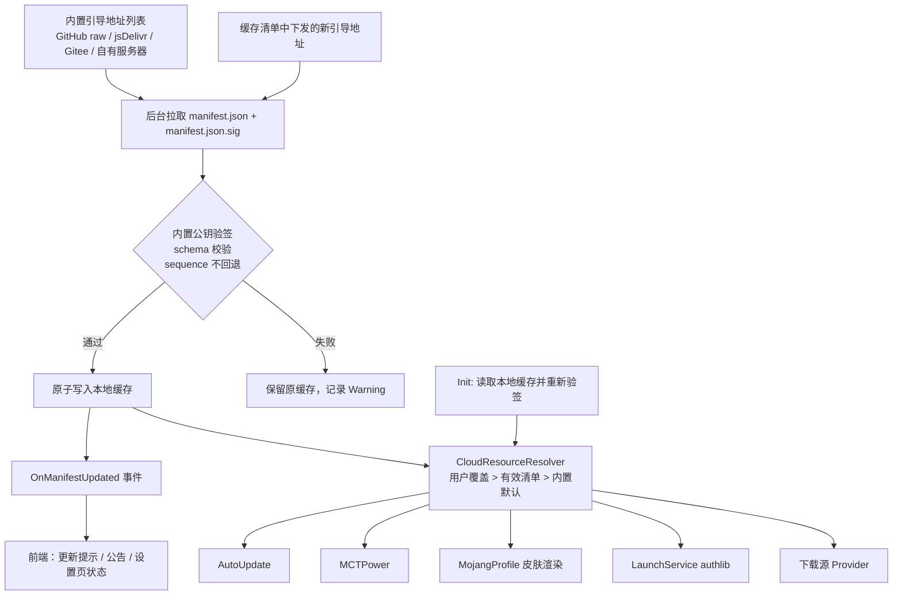

# OneLauncher 云资源更新同步（远程资源清单）可行性研究

研究日期：2026-11-13。依据当前工作区源码进行静态分析；本次仅新增研究文档，没有修改业务代码、运行应用或执行测试。下文的新类型、字段、文件与地址均为建议，尚未实现。

## 1. 结论

**可行，且与现有架构契合度较高，建议分阶段实施。** 项目已具备实现所需的全部基础：共享 `Download`/`HttpClient`、带原子写入与校验钩子的 `BasicDataManager<T>`、System.Text.Json 源生成、`Tools.ReplacePlaceholders` 占位符替换、`UnitedCore` 组合入口和 `OnDataChanged` 事件模式。不需要引入新依赖或重构业务架构。

真正需要设计的不是“下载一个 JSON”，而是以下四点：

1. **安全**：清单会决定启动器去哪里下载并执行 `main.exe`（MCT 联机核心）和 `install.ps1`（更新脚本）。清单一旦被篡改即等同远程代码执行，**必须对清单做签名校验**，仅依赖 HTTPS 不够（清单托管点本身可能被接管，项目已经历过一次仓库被封迁移）。
2. **永不阻塞、永不变砖**：任何情况下（断网、清单损坏、托管点失效）都要回退到“本地缓存 → 内置默认值”，不能让清单成为新的单点故障。
3. **自举问题**：清单地址本身也会失效，需要多镜像引导地址，并允许已签名的清单下发新的清单地址。
4. **使用时解析**：现有组件把地址写成 `const`，需改为“使用时向解析器取值”，清单后台刷新后才能即时生效。

工程复杂度：核心后端中等（约 1 个新管理器 + 1 个模型/上下文 + 签名校验 + 4~6 处调用点改造）；发布侧需要新增签名与发布流程。按项目约定，后端接口应由贡献者设计，Agent 负责前端接入，见第 9 节。

## 2. 现状：硬编码的外部地址清单

扫描 `OneLauncher.Core` 与 `OneLauncher` 中的全部 URL 后，按“失效风险 / 是否适合由清单下发”分类如下。

### 2.1 高风险第三方或自有资源（首期纳入清单）

| 资源 | 源码位置 | 现状问题 |
| --- | --- | --- |
| 版本更新检查 | `Core/Global/AutoUpdate.cs` `CheckUpdateUrl` | 从 `raw.githubusercontent.com/lnetface/.../Version.cs` 下载 **C# 源码**再手工找引号解析版本号；仓库或文件改名即失效；每次 `new HttpClient()` |
| Windows 更新脚本 | `AutoUpdate.cs` `UpdaterUrlWindows`；`build/install.ps1` `$repository` | 脚本地址与脚本内部仓库名都写死；下载后直接 `powershell.exe` 执行，无任何校验 |
| MCT 联机核心 | `Core/DefaultComponent/ConnectToolPower/MCTPower.cs` `CoreUrl`、`CoreMd5` | 注释显示已从 gitee 迁到 `api.mct.mczlf.loft.games` 一次；核心每次更新都必须发版启动器同步 MD5 |
| 皮肤全身渲染 | `Core/DefaultComponent/Account/Microsoft/MojangProfile.cs` `GetSkinHeadImage` | 注释显示已从 `crafatar.com` 切到 `crafatar-pub.neodium.fr` 一次；无备用地址 |
| authlib-injector | `Core/DefaultComponent/Launcher/LaunchService.cs` `PrepareGameData` | 版本号 `artifact/53/...1.2.5.jar` 写死；只在文件不存在时下载，无校验 |
| OneLauncher 下载源 | `.../DownloadSources/OlanSourceDownloadUrlGetter.cs` | `http://110.42.59.70:8840/` 明文 HTTP 裸 IP，换服务器即失效 |
| SkyCrystal / BMCLAPI 镜像 | `SkyCrystalSourceDownloadUrlGetter.cs`、`BmlcSourceDownloadUrlGetter.cs` | 第三方镜像根地址写死 |
| 项目主页 | `Core/Global/Init.cs` `ProjectWebsite`；设置页“关于”按钮 | 仓库已迁移过一次；**README 的一键安装命令仍指向已被封的 `zhweaa/OneLauncher`**，正是本需求要解决的问题的现成例证 |

### 2.2 中风险第三方服务（次期纳入，可选覆盖）

| 资源 | 位置 | 说明 |
| --- | --- | --- |
| 服务器状态 `api.mcstatus.io` | `Core/Helper/Models/ServerEntry.cs` | 免费公共 API |
| NameMC 皮肤 `s.namemc.com` | `OneLauncher/ViewModels/Panes/SkinMangerPaneViewModel.cs` | 前端直接 `new HttpClient()` 请求；建议顺带下沉到后端 |
| LittleSkin Yggdrasil 根 | `.../Yggdrasil/ServiceProviders/LittleSkinAuthenticator.cs` | 一般稳定 |
| Java 发行版 API（Adoptium/Azul/Oracle/Microsoft） | `Core/DefaultComponent/JavaProviders/*` | 官方 API，稳定；仅在需要镜像时覆盖 |
| Mojang 新闻 | `Core/Minecraft/NewReader.cs` | 官方，稳定 |

### 2.3 不建议由清单下发

| 资源 | 原因 |
| --- | --- |
| Microsoft/Xbox/Minecraft Services 认证端点、MSAL Authority、`ApplicationID` | 远程可改即意味着令牌可被重定向窃取；官方端点极少变更 |
| Mojang 版本清单、资源、库地址（官方源） | 下载源策略的基准地址，且有 SHA-1 校验；保持内置 |
| Fabric/Quilt/Forge/NeoForge 元数据与 Maven、Modrinth API | 官方带版本号的 API，变更通常伴随协议变化，单改地址无法修复 |

### 2.4 顺带发现的相关缺陷（实施前或同时处理）

- **MCT 校验逻辑与清单下发不兼容**：`MCTPower.InitializationAsync` 在本地 `main.exe` 已存在但 MD5 不符时，会删除文件并抛出 `FatalError`（前端随即退出程序）。若通过清单更换核心版本与散列，所有已有旧核心的用户首次进入都会被判为“网络环境不安全”并退出。必须改为“散列不符 → 重新下载 → 再校验，仍不符才报错”，且联机属于可选能力，错误级别建议降为 `Error`。
- `DefaultConfig.CrafatarUrl`（`DBManager.cs`，值为 `http://106.55.4.15:18792/renders/body/`）已无任何读取方，却仍被写入每个用户的 `config.json`。是“曾经尝试用配置解决此问题”的遗留，可随本功能移除或改作用户手动覆盖项。
- `VersionsList.GetOrRefreshVersionListAsync` 的后台刷新为无人观察的 `_ = Task.Run(...)`。清单后台刷新不应复制该写法（见第 5.4 节）。
- `install.ps1` 只查找名为 `OneLauncher.Desktop.exe` 的 Release 资产，而 CI 产出的是 `OneLauncher-<rid>-AOT.zip`；目前依赖人工上传。清单可以直接下发每个 RID 的资产地址与散列，从而解耦。

## 3. 方案比较

| 方案 | 优势 | 限制 | 结论 |
| --- | --- | --- | --- |
| 维持现状，靠发版修复 | 无工作量 | 第三方变更即功能损坏，旧版本永久损坏；与需求相悖 | 否 |
| 仅从 GitHub Release / API 读取最新版本 | 简单 | 只解决版本检查；GitHub 国内可达性差；仓库再次被封即全部失效 | 否 |
| 远程清单，仅 HTTPS、不签名 | 实现最快 | 托管点被接管或镜像被投毒 → 可下发任意 exe 与脚本并让其通过校验 | **不可接受** |
| **远程清单 + 内置公钥签名 + 多镜像 + 本地缓存 + 内置默认值** | 镜像不再需要可信；可随时切换托管点；离线可用 | 需维护签名私钥与发布流程 | **推荐** |
| 自建完整配置服务（动态接口、灰度、统计） | 灵活 | 需要长期运维服务器；隐私与成本增加 | 当前规模不需要 |

## 4. 建议架构



### 4.1 清单格式建议

使用强类型模型而非任意键值字典：键在编译期确定，便于 AOT 源生成，旧版本也无法使用它不认识的键。URL 模板复用现有 `${KEY}` 占位符风格和 `Tools.ReplacePlaceholders`。

```json
{
  "schemaVersion": 1,
  "sequence": 42,
  "issuedAt": "2026-11-13T00:00:00Z",
  "manifestUrls": [
    "https://raw.githubusercontent.com/lnetface/OneLauncher-cloud/main/manifest.json",
    "https://cdn.jsdelivr.net/gh/lnetface/OneLauncher-cloud@main/manifest.json"
  ],
  "launcher": {
    "latestVersion": "1.6.1.0",
    "minimumSupportedVersion": "1.5.0.0",
    "projectUrl": "https://github.com/lnetface/OneLauncher",
    "releaseNotesUrl": "https://github.com/lnetface/OneLauncher/releases/tag/v1.6.1.0",
    "assets": {
      "win-x64": { "url": "https://.../OneLauncher-win-x64-AOT.zip", "sha256": "..." }
    },
    "updateScript": {
      "windows": { "url": "https://.../install.ps1", "sha256": "..." }
    }
  },
  "resources": {
    "skinBodyRender": [
      "https://crafatar-pub.neodium.fr/renders/body/${UUID}",
      "https://crafatar.com/renders/body/${UUID}"
    ],
    "mctCore": { "url": "https://api.mct.mczlf.loft.games/mainnew.exe", "sha256": "...", "md5": "08160296509deac13e7d12c8754de9ef" },
    "authlibInjector": { "url": "https://authlib-injector.yushi.moe/artifact/53/authlib-injector-1.2.5.jar", "sha256": "..." },
    "serverStatusApi": "https://api.mcstatus.io/v2/status/java/${ADDRESS}"
  },
  "downloadMirrors": {
    "olan": "https://.../",
    "bmcl": "https://bmclapi2.bangbang93.com/",
    "skyCrystal": "https://api.skycrystal.fun/mc/java/"
  },
  "announcements": []
}
```

设计要点：

- `schemaVersion` 只在不兼容变更时递增；旧版本遇到更高的主版本时忽略该清单、继续使用缓存或内置值，并提示更新。兼容变更只加字段，反序列化跳过未知成员。
- `sequence` 单调递增，用于**防回滚**：攻击者即使拿到一份旧的合法签名清单（其中含有已被接管的旧地址），也无法让客户端倒退。
- 可执行或会被加载的资源（MCT 核心、更新脚本、启动器资产、authlib jar）**必须同时下发 SHA-256**，地址和散列成对出现。MCT 保留 `md5` 字段仅为过渡兼容。
- 列表型字段（如 `skinBodyRender`）表示按顺序回退的候选，直接解决“crafatar 换过一次”的问题。
- 签名使用分离文件 `manifest.json.sig`，对原始字节签名，避免 JSON 规范化问题。

### 4.2 签名

- 推荐 ECDSA P-256 + SHA-256：`System.Security.Cryptography.ECDsa` 为 BCL 内置，Windows/Linux/macOS 均可用，不依赖反射，适合 Native AOT。项目已在 `Download.cs`、`Tools.cs` 等处使用 `System.Security.Cryptography`。实际 AOT 三平台发布后仍需验证一次。
- 启动器内置 1~2 把公钥（当前 + 备用），轮换密钥通过发版完成；私钥只存放在 GitHub Actions Secret 或维护者本机，不进入仓库。
- 验签对象包括网络下载的清单**和读取的本地缓存**（缓存文件在用户目录中，可被其他程序改写）。

### 4.3 自举与托管

- 内置多个引导地址，顺序或竞速请求，第一个验签通过且 `sequence` 不低于缓存的即采用。签名使镜像无需可信，可放心使用 jsDelivr、Gitee、自有服务器等。
- 已签名的清单可通过 `manifestUrls` 下发新的引导地址并写入缓存，下次启动优先使用。这样即使内置的全部地址失效，只要用户曾经成功拉取过一次，就仍可迁移。
- 建议托管在独立仓库或独立分支（例如 `OneLauncher-cloud`），与主仓库解耦，避免仓库被封时清单同时失效。清单源文件与签名脚本可以放在 `build/cloud/`，符合根目录只允许 `docs`/`build` 两个非代码目录的规定。

## 5. 与现有代码的对接

### 5.1 新增类型（建议）

| 类型 | 位置 | 职责 |
| --- | --- | --- |
| `CloudManifest` 及子模型、`CloudManifestJsonContext` | `OneLauncher.Core/Global/ModelDataMangers/` 或新建 `Core/Global/Cloud/` | 清单数据根与源生成上下文，按规范与管理器相邻 |
| `CloudManifestManager` | 同上 | 读取/验签/保存缓存，后台刷新，`OnManifestUpdated` 事件；保存可复用 `BasicDataManager<T>` 的临时文件替换路径，通过 `ValidateData` 与 `RequireValidDocument` 拒绝损坏文档 |
| `CloudResourceResolver`（可与 Manager 合并） | 同上 | 提供 `GetSkinBodyRenderUrls(uuid)`、`GetMctCore()` 等强类型查询；内部执行“用户覆盖 > 有效清单 > 内置默认”的优先级 |
| `ManifestSignatureVerifier` | 同上，`internal` | 内置公钥与验签 |

注意 `BasicDataManager<T>.InitializeAsync` 在文件不存在时会创建默认数据并写盘。清单缓存不应把“内置默认值”写成一份无签名的缓存文件，建议：要么在缓存缺失时不调用其默认创建路径，要么让 Manager 自行实现读写、只复用原子替换的思路。具体由后端设计者决定。

### 5.2 初始化顺序

当前链路为 `Program.cs` 启动 `Init.InitTask = Init.Initialize()`，`MainWindow` 用 `GetAwaiter().GetResult()` **同步等待**它完成。因此：

1. 在 `Init.Initialize` 中，`DBManager` 和 `Download` 创建之后、`UnitedCore.Initialize()` 之前，**只读取本地缓存并验签**（纯文件 I/O，不联网），保证 `UnitedCore` 内的组件和首页立即预初始化的 MCT（`HomePageViewModel` 构造时即调用 `PowerPlayPaneViewModelFactory.CreateAsync`）一开始就拿到最新可用地址。
2. 网络刷新放在初始化完成之后，例如由首页现有的 `Task.Run(AutoUpdate.CheckUpdate)` 位置改为“刷新清单 → 根据清单判断更新”。网络请求须设置较短超时（建议 5~10 秒）并接受取消。
3. 命令行入口（`OneLauncher.Console/Boot.cs`，`--quicklyPlay` 等）只使用缓存，不发起刷新，避免拖慢快速启动。

新 Manager 通过 `UnitedCore` 的 `required init` 属性暴露，并按规范注册到现有 `ServiceCollection`，不另建容器。

### 5.3 调用点改造

| 调用点 | 改造方式 | 改动量 |
| --- | --- | --- |
| `AutoUpdate.CheckUpdate` | 改为比较 `launcher.latestVersion` 与 `Init.ApplicationVersoin`；清单不可用时保留现有 Version.cs 解析作为兜底 | 小 |
| `AutoUpdate.Update` | 脚本地址与 SHA-256 来自清单；下载后校验再执行；建议 `install.ps1` 接受仓库名或资产直链参数，使清单可控制安装来源 | 小～中（含脚本） |
| `MCTPower.InitializationAsync` | 地址/散列来自解析器；修正第 2.4 节的“不符即致命退出”逻辑 | 中 |
| `MojangProfile.GetSkinHeadImage` | 遍历候选模板，逐个尝试 | 小 |
| `LaunchService.PrepareGameData` | authlib 地址来自解析器；补充散列校验；若清单版本更新则替换旧 jar | 小 |
| `OlanSourceDownloadUrlGetter` 等 | 根地址改为属性/构造参数并由解析器提供；三个镜像目前都是“替换前缀”模式，接入成本低 | 小 |
| `Init.ProjectWebsite` | 设置页“关于”改用清单的 `projectUrl`，常量保留为默认值 | 小 |
| 首页更新提示文案 | “建议前往GitHub下载最新版本”改为使用清单的 `releaseNotesUrl` 等信息 | 小（前端） |

关键原则：组件**每次使用时**向解析器取值，不在构造时快照，后台刷新完成后无需重启即可生效（已在运行的下载任务保持原地址即可）。所有内置常量保留为默认值，不删除。

**动态新增下载源属于次期能力**：`DownloadSourceStrategy` 是枚举且已持久化到 `config.json`，`DownloadMinecraft` 用 `switch` 选择 Provider。若要仅凭清单就新增一个全新镜像，需要引入数据驱动的“前缀替换镜像 Provider”并调整设置页与配置格式（涉及迁移）。首期只做“已有镜像的地址可更新”。

### 5.4 并发与错误处理

- 后台刷新必须被观察：由 Manager 持有刷新 `Task`，内部捕获异常并以 `OlanExceptionAction.Warning` 记录（现有日志系统会自动写入文件），不得使用裸 `_ = Task.Run(...)` 丢弃异常。
- 刷新与读取用锁保护快照；采用 `VersionListManager` 的“候选数据 → 校验 → 保存 → 发布快照 → 释放锁 → 触发事件”顺序。
- 验签失败、`sequence` 回退、`schemaVersion` 不支持，一律视为“本次刷新无效”，保留原缓存，不影响任何功能。
- 事件不保证在 UI 线程触发，前端自行切换线程并在页面销毁时解除订阅。

### 5.5 AOT 与平台

- 清单模型使用 `JsonSerializable` 源生成上下文和 `JsonTypeInfo` 重载，未知字段跳过，与 `AppConfig` 的 `[JsonUnmappedMemberHandling(Skip)]` 做法一致。
- `ECDsa.ImportSubjectPublicKeyInfo` / `VerifyData` 无反射依赖。
- 更新脚本仅 Windows（`ONELAUNCHER_TARGET_WINDOWS`）；Linux/macOS 只显示新版本提示与发布页链接，清单的 `assets` 按 RID 区分即可。

## 6. 发布侧流程

1. 维护者修改 `build/cloud/manifest.json`（递增 `sequence`）。
2. 用签名脚本（建议新增 `build/cloud/Sign-Manifest.ps1`，或 GitHub Actions 工作流读取 Secret）生成 `manifest.json.sig`。
3. 推送到清单仓库/分支；jsDelivr 等镜像自动同步（注意 CDN 缓存延迟，客户端只依赖 `sequence`，不依赖时效）。
4. 发版时，CI 可自动计算各 RID 资产的 SHA-256 并写入清单，再签名发布。

签名前应做 schema 校验和所有 URL 的可达性检查，避免发布一份“合法签名但内容错误”的清单。由于有 `sequence` 防回滚，修正错误只能发布更高序号的新清单，这一点需要告知维护者。

## 7. 风险与对策

| 风险 | 对策 |
| --- | --- |
| 清单或镜像被篡改，下发恶意 exe/脚本 | 内置公钥验签；可执行资源强制 SHA-256；认证端点不允许下发 |
| 签名私钥泄露 | 内置备用公钥，发版移除被泄露的公钥；私钥仅存 Secret |
| 重放旧清单 | `sequence` 单调递增并持久化 |
| 所有引导地址同时失效 | 多托管点 + 清单可下发新引导地址 + 内置默认值兜底 |
| 网络慢拖慢启动 | 初始化阶段只读缓存；网络刷新在后台、带超时 |
| 清单内容错误导致功能损坏 | 发布前校验；客户端对单个资源仍保留内置默认值作为最后回退（例如候选列表全部失败时再试内置地址） |
| 隐私 | 每次刷新会向托管点暴露 IP 与 UA；应更新 `Privacy_Policy.md` 说明该请求，且不附带任何账户或设备标识 |
| MCT 核心随清单更新导致老用户被强制退出 | 实施前修正 `MCTPower` 校验逻辑（第 2.4 节） |

## 8. 建议分期

| 阶段 | 内容 | 前置 |
| --- | --- | --- |
| P0 | 修正 `MCTPower` 散列不符的处理；`AutoUpdate` 复用共享 `Download` | 无 |
| P1 | 清单模型、签名校验、缓存、Manager/解析器、初始化接入；改造版本检查、更新脚本、MCT、皮肤渲染、authlib；签名脚本与首份清单 | 确定托管点与密钥 |
| P2 | 下载镜像根地址、mcstatus、NameMC（顺带下沉到后端）、项目主页、公告；设置页显示清单状态（序号、更新时间、来源）与手动刷新；更新 `Privacy_Policy.md` | P1 |
| P3 | 数据驱动的镜像 Provider（清单可新增下载源）、CI 自动写入资产散列；可选的用户手动覆盖地址 | P2 |

## 9. 需要贡献者决定的事项

依据 `AGENT_MUST_READ_FIRST.md`，后端由贡献者设计。以下事项在动工前需要人工确定：

1. 清单托管位置（独立仓库/分支、是否使用自有服务器）及内置引导地址列表。
2. 签名算法与密钥保管方式（本文建议 ECDSA P-256，私钥存 GitHub Secret）。
3. 后端接口形态：`CloudManifestManager` 是否继承 `BasicDataManager<T>`，解析器采用强类型方法还是带默认值的属性，以及 `OnManifestUpdated` 事件签名。前端接入（更新提示、公告、设置页状态）依赖这一事件，缺失时前端只能轮询，违反前端规范。
4. 首期纳入清单的资源范围（建议以第 2.1 节为准）。
5. 是否允许用户在设置中手动覆盖地址（便于镜像失效时自救，但增加配置项与支持成本）。
6. `DefaultConfig.CrafatarUrl` 移除还是改作用户覆盖项。

## 10. 涉及文件（预估）

新增：`OneLauncher.Core/Global/Cloud/`（或 `ModelDataMangers/` 下）的清单模型、JSON 上下文、Manager、验签器；`build/cloud/manifest.json`、签名脚本；实施完成后的 `docs/AI_Generated` 说明文档。

修改：`Core/Global/Init.cs`、`UnitedCore.cs`、`AutoUpdate.cs`、`DefaultComponent/ConnectToolPower/MCTPower.cs`、`DefaultComponent/Account/Microsoft/MojangProfile.cs`、`DefaultComponent/Launcher/LaunchService.cs`、`DownloadSources/*SourceDownloadUrlGetter.cs`、`build/install.ps1`；前端 `HomePageViewModel.cs`、`SettingsPageViewModel.cs`（及 `settings.axaml`）；`Privacy_Policy.md`；`README.md`（修正指向旧仓库的一键安装命令）。
