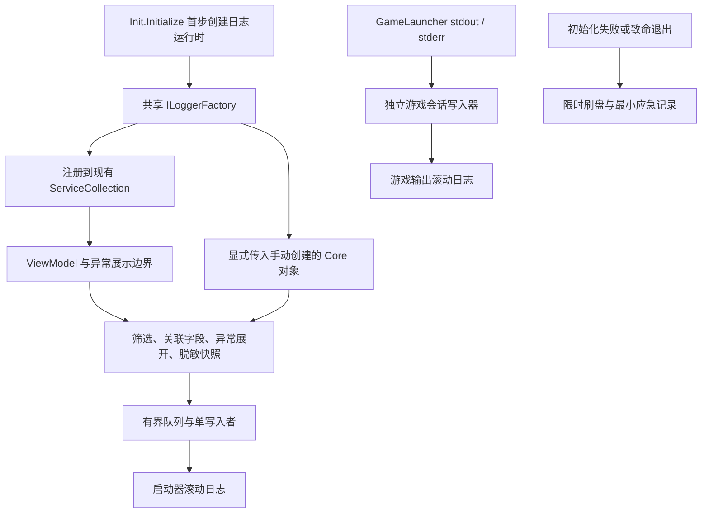

# OneLauncher 日志系统可行性研究

研究日期：2026-11-12。依据当前工作区源码进行静态分析；本次仅新增研究文档，没有修改业务代码、安装依赖、运行应用或执行测试。下文的新类型、参数与文件均为建议，尚未实现。

## 1. 结论与适用范围

**增加日志系统可行，建议分阶段实施。** 项目已有 .NET 10、依赖注入、任务状态事件和游戏进程输出事件，能够接入统一日志接口，无需重构业务架构。建议使用 `Microsoft.Extensions.Logging` 作为调用契约，首期实现一个职责受限的异步滚动文件 Provider；游戏输出通过独立会话写入器保存，复用同一套文件管理和脱敏规则。

基础能力的工程复杂度为中等。真正需要设计的部分是初始化顺序、退出刷盘、并发及容量控制、异常关联、敏感信息处理，而不只是增加 `WriteLine`。实时日志浏览界面、云端收集、自动上传和崩溃分析不纳入首期。

本结论是源码层面的可行性判断，**不代表已经验证 Native AOT 发布、运行性能或第三方日志包兼容性**。正式实施时须通过小范围验证确认这些条件。

## 2. 当前实现与问题

| 已核实的实现 | 源码位置 | 对日志系统的影响 |
| --- | --- | --- |
| 全项目目标框架为 `net10.0`；Core 引用 `Microsoft.Extensions.Hosting` 10.0.10 | `Directory.Build.props`、`OneLauncher.Core/OneLauncher.Core.csproj` | 当前本地还原清单包含 Logging、Abstractions、Console 等依赖，可使用现有 .NET 日志契约；依赖存在不等于已配置日志 |
| 初始化使用 `ServiceCollection`；多数核心对象由 `UnitedCore.Initialize()` 手动创建 | `OneLauncher.Core/Global/Init.cs`、`UnitedCore.cs` | 单独调用 `AddLogging()` 不会自动把日志传入 `new` 出来的对象，需要显式传递依赖 |
| 大量诊断信息使用 `Debug.WriteLine`，少量使用 `Trace.TraceWarning/Error` | 下载、任务、启动、配置、资源安装等组件 | `Debug` 调用通常在 Release 中移除；Trace 也没有发现统一的应用文件 Listener，现有信息不能作为稳定的用户诊断记录 |
| 入口捕获异常并覆盖写入程序目录下的 `crash_log.txt` | `OneLauncher.Desktop/Program.cs` | 仅覆盖逃逸到入口的异常；程序目录可能不可写，写文件失败可能遮蔽原始异常，多次失败也会覆盖历史记录 |
| Avalonia 使用 `.LogToTrace()` | 同上 | 框架诊断与业务日志尚未统一；要单独确认 Avalonia 12.1.4 的级别和输出桥接，不能假设业务日志配置自动接管 |
| 初始化在桌面入口调用，主窗口等待 `Init.InitTask`，并处理部分业务异常 | `Init.cs`、`OneLauncher/Views/MainWindow.axaml.cs` | 文件日志必须早于配置读取和网络初始化，否则无法解释初始化失败 |
| 异常由 `OlanExceptionWorker` 展示，致命错误使用 `Environment.Exit(1)` | `OneLauncher/Codes/OlanExceptionWorker.cs` | 错误提示不等于持久化诊断；立即退出前需要主动记录和限时刷盘 |
| 命令行入口异常使用 `Environment.FailFast` | `OneLauncher.Console/Boot.cs` | `finally`、常规释放和进程退出处理不能被假设会执行，需要在调用前尽力保存错误 |
| `OlanException` 将底层异常保存在 `OriginalException`，未传给基类 `InnerException` | `OneLauncher.Core/Global/OlanException.cs` | 普通日志库对异常链的默认格式化可能遗漏底层原因，应显式处理这个属性 |
| 任务失败只保存异常并输出到 Debug；任务没有稳定 ID | `OneLauncher.Core/Global/TaskManager.cs` | 可在现有状态变化处记录生命周期，但建议增加仅运行期使用的任务关联 ID |
| 游戏 stdout/stderr 已重定向，并触发 `GameOutputEvent` | `GameLauncher.cs`、`LaunchService.cs` | 能在 Core 内独立落盘，无需依赖调试窗口是否打开 |
| 只有调试模式订阅输出消息；窗口缓存约 50 Ki 字符并截断 | `OneLauncher/Codes/LaunchGame.cs`、`GameTaskerViewModel.cs` | 当前窗口不是完整日志存储，正常启动也需要独立采集 |
| 最终游戏启动参数异步写入 `LastLaunchArgs.bat` | `GameLauncher.cs`；令牌参数来自 `Builders/GameArgsBuilder.cs` | 完整参数可能含 `--accessToken`，不能直接复制到新日志或导出包 |
| 有跨平台、裁剪和 Native AOT 发布配置 | `build/PublishProfile.props`、桌面项目发布配置 | 必须避免反射配置、任意对象解构和动态加载；实际发布仍须验证 |

源码中的 Minecraft `logging` 模型和 JVM `log4j.configurationFile` 属于游戏自身的日志配置，不能替代启动器日志。旧文档介绍的 `OneLauncher.Core.Net` 不作为新增日志的代码归属；本研究采用当前实际引用的 Core 实现。

## 3. 方案比较

| 方案 | 优势 | 成本与限制 | 结论 |
| --- | --- | --- | --- |
| 增加 Trace 文件 Listener | 改动少，可承接部分已有 Trace 与 Avalonia 输出 | 无法恢复被编译移除的 Debug 调用；任务上下文、异步写入和保留策略仍需补充 | 可作为局部桥接，不适合作为长期主接口 |
| `Microsoft.Extensions.Logging` + 自有小型文件 Provider | 契约通用；利用现有依赖；可显式控制 AOT、文件布局、脱敏和故障降级 | 框架内置 Provider 不提供通用滚动文件能力；队列、轮转、刷盘和清理需要维护 | **首期推荐**，严格限制功能范围 |
| `Microsoft.Extensions.Logging` + Serilog 文件输出 | 文件轮转和结构化输出成熟；业务仍依赖标准接口 | 增加包与版本管理；具体 Sink、异步组件、配置方式须核实 AOT/裁剪；脱敏和退出控制依然需要设计 | 团队不希望维护文件 Provider 时的优先备选；通过代码配置并先做发布验证 |
| NLog | 文件目标、过滤和布局功能丰富 | 对本项目首期需求配置面较大；确切版本及反射相关功能需要验证 | 可选，但目前没有必须采用它的需求 |
| 完全自定义日志接口和框架 | 可完全定制 | 重复建设级别、分类、作用域和生态适配，后续迁移成本较高 | 不建议 |

推荐方案不意味着自有实现天然更可靠或绝对更轻。它只针对本地文件、有限字段、固定轮转和有限队列，不扩展成通用日志框架。如果这些边界不能保持，应改用验证过的成熟文件输出组件。没有实测前，不给出包体积或吞吐量优劣结论。

## 4. 建议架构

### 4.1 初始化与对象创建

1. 在 `Init.Initialize()` 最前面、创建目录和读取配置之前启动日志运行时。日志目录创建失败本身进入降级流程，不能成为启动失败的新原因。
2. 使用不依赖配置文件的默认值，随后读取配置；配置有效时调整级别和保留策略。配置损坏仍能留下记录。
3. 同一个 `ILoggerFactory` 注册到现有容器，并显式传给 `UnitedCore.Initialize()` 和相关手动创建的服务。不能为了获得 Logger 再建立一套临时 ServiceProvider。
4. 新的实例组件使用 `ILogger<T>`；静态和旧组件可在限定范围内通过日志运行时获取分类 Logger，逐步迁移，避免批量改写历史构造函数。
5. 日志资源由一个明确的运行时所有者关闭。容器注册方式、释放列表与命令行 `using` 都不能造成重复 Dispose。关闭操作应幂等。

目前 `docs/AI_Instruction/前端设计规范.md` 明确规定 `OneLauncher.Desktop` 是启动项目且“不允许更改”。因此首期方案不修改 `Program.cs`，以 Core 初始化作为最早接入点。这可以覆盖初始化及随后绝大多数受控路径，但无法保证覆盖运行时加载、`Init` 静态初始化或调用日志运行时之前的失败，也无法修复入口旧 `crash_log.txt` 的写入问题。若后续要求完全替换入口崩溃记录，需要先明确允许调整该项目的约束；这不妨碍先建设 Core 日志。

### 4.2 日志内容与级别

首期使用可直接阅读的 UTF-8 文本，包含带时区的时间、Level、Category、EventId、进程 ID、启动器 SessionId，以及可选 TaskId、GameSessionId、InstanceId、耗时和异常详情。实例标识只在确有诊断价值时记录，不默认记录玩家身份或服务器地址。

- `Information`：启动与配置加载结果、任务开始/完成/主动取消、游戏启动/退出及汇总。
- `Warning`：可恢复的下载重试、源切换、非关键清理失败。
- `Error`：最终任务失败、认证失败、无法启动游戏。非零游戏退出码还需结合主动取消等上下文判断。
- `Critical`：启动器无法继续工作的致命异常。
- `Debug/Trace`：逐文件、分片、参数构建等详细诊断，默认关闭。

Release 默认业务级别建议 `Information`。第三方/框架诊断通常从 `Warning` 起步。不同分类允许独立阈值，避免一开 Debug 就记录海量网络信息。状态为 Canceled 的正常取消不写 Error；超时和非预期取消按上下文区分。

高频事件优先使用 `[LoggerMessage]` 源生成固定模板，在筛选之后再构建昂贵消息。首期文本保留关联字段，未来若需要 JSONL，使用显式数据模型和 `JsonSerializerContext`，不序列化任意 `object` 或整个异常/账户对象。

### 4.3 文件位置、轮转和容量

正式运行建议放在 `Path.Combine(Init.BasePath, "logs")`，即用户现有的 OneLauncher 数据目录，而不是程序安装目录或可更改的游戏安装目录。研发验证必须注入工作区内日志根目录，例如 `build/logging-validation-20261112`，不得直接运行并向工作区外的用户目录写入测试文件。

每个启动器进程使用独立 SessionId，并在文件名包含时间、PID、随机会话标识和轮转序号，避免桌面和快捷启动同时运行时争用同一文件。建议分为 `launcher/`、`game/`、`crash/`，游戏文件额外关联 GameSessionId。

建议初始策略（均为待验证、可调整的默认值）：

| 项目 | 建议值 |
| --- | --- |
| 启动器日志单文件大小 | 5 MiB |
| 游戏输出单文件大小 | 10 MiB |
| 每个游戏会话总量 | 50 MiB，超限明确记录截断/覆盖策略 |
| 历史保存时间 | 7 天 |
| 所有受管日志总量 | 200 MiB，历史文件按时间回收 |
| 单条记录上限 | 16 KiB，截断处加标记，避免异常消息无限膨胀 |

总量限制优先于日期；仅有单文件轮转并不能限制磁盘增长。多进程下的总量是尽力维持的软限制，需要排除其他活跃会话文件，避免删除正在写入的文件；必要时使用受限的清理协调机制。只清理日志根目录内符合自身命名规则的文件，核对解析后的路径，避免越界或跟随重解析点删除其他目录。`last-session` 之类的索引也不能成为多进程写入的共享争用点。

### 4.4 并发、队列与故障处理

普通调用只生成已脱敏、不可变的记录快照并入队，由单写入者追加文件；不要在下载线程、进程输出回调或 UI 线程同步写盘。不能把延后格式化的 Scope 引用或仍可变的状态对象直接塞进队列，否则离开作用域后会丢失 TaskId 等上下文。

使用有界 `Channel`，例如最多 4096 条；配合每条最大字节数控制内存。还要考虑文本、异常快照和多个游戏会话的总内存，不能把条数直接当作内存上限。启动器和游戏流应分别限额，防止游戏刷屏挤掉启动器错误。

队列满时普通记录采用非阻塞丢弃/采样，并汇总丢弃数量；Error/Critical 不能只静默丢弃，应进入受限的高优先级通道或专门的最小应急记录路径。应急写入也必须受容量及次数限制，不能把每个 Error 变成调用线程上的同步磁盘等待。

磁盘满、权限错误或文件被占用时，暂停对应文件输出、保留有限的内存尾部记录，允许 stderr 或调试输出作为降级渠道。重试采用退避，内部故障不得递归调用同一个日志 Provider。对 WinExe 来说 stderr 不保证用户可见，因此不能将其视为可靠文件存储替代。

## 5. 异常记录与退出保证

### 5.1 记录边界和关联

异常原则上在“决定失败如何处理”的边界记录一次。底层若只是包装后继续抛出，不重复写 Error。`TaskInstance.SetFailed` 与 `OlanExceptionWorker` 可能处理同一错误，需要共享 FailureId/TaskId 或携带已记录标记，让 UI 可引用记录而不重复产生完整堆栈。

对 `OlanException` 同时记录 Title、Action、Message 和 `OriginalException`；普通异常保留类型、堆栈及 InnerException。异常遍历限制深度并防止重复引用，文本经过脱敏。修正基类异常链是另一种局部改造选择，但必须保留现有公开属性兼容，不需要为了日志统一所有异常模型。

### 5.2 正常与异常退出

- 正常桌面退出：先停止业务日志生产，再限时排空队列并关闭写入器。`MainWindow.OnClosing` 可被取消且现有释放顺序没有专门的日志生命周期，不能直接把异步刷盘塞入循环；宜由应用生命周期退出协调或运行时所有者统一收尾。
- 命令行返回：`Boot.RunBoot` 在成功和失败路径都协调关闭，不依赖窗口的资源释放。
- `OlanExceptionAction.FatalError`：先写 Critical，限时刷盘，再执行现有终止策略。
- `FailFast`：必须在调用前尝试记录和刷盘；不要期望 `finally`、`ProcessExit` 或服务释放补救。
- 可考虑在日志运行时注册 `AppDomain.UnhandledException`、`TaskScheduler.UnobservedTaskException`，UI 线程异常则核实 Avalonia 的对应事件后接入。它们是补充证据，不用于吞掉故障或宣称能够捕获所有异常。

致命路径建议最多等待约 1–2 秒，并提供不经过失效主队列、不会递归的应急写入。强制杀进程、断电、原生崩溃、严重内存不足等场景仍可能丢失最后记录；常规 Flush 也不等价于断电安全。首期目标是可靠保存受控退出和大部分可观察失败，不承诺零丢失。

## 6. 游戏输出、下载与隐私

### 6.1 游戏输出

在 `GameLauncher`/`LaunchService` 所属的 Core 层采集，而不是订阅前端 `GameMessage` 落盘，保证普通启动、调试启动和命令行启动一致。每次启动创建独立会话文件，并记录 Java 版本、Minecraft 版本、加载器、PID、启动阶段、实际退出码及是否主动取消。

保留 stdout/stderr 来源标签，但 stderr 不自动映射为启动器 Error：Java 和模组可能把普通信息写到 stderr。当前 UI 的 `[ERROR]` 文本只能作为来源表现，不能直接用作日志严重性判断。

退出时需要协调 stdout/stderr 读取结束与写入器完成。`Process.Exited` 不代表异步输出回调已经全部送达，不能一收到事件就关闭日志；同时尊重取消并设置等待上限。多游戏会话不能共享无界缓存。

Minecraft 自带的 `latest.log`、`crash-reports` 等可以作为后续用户主动导出的补充材料，首期无需解析或替代它们。

### 6.2 下载与认证

下载默认记录操作汇总、来源域名、重试次数、HTTP 状态、耗时和最终失败。逐文件/逐分片诊断限于 Debug 并设采样，进度更新不逐次入日志。源竞速中被主动取消的请求属于正常控制流。

认证只记录认证阶段、结果、可公开的 SDK 错误码及耗时。不得为了诊断而开启 SDK 的敏感信息输出，也不记录请求头、认证请求体或完整响应体。

### 6.3 脱敏与导出边界

1. 禁止记录 accessToken、refreshToken、密码、Bearer/Authorization、客户端令牌、API Key 和完整账户配置。使用允许字段清单，避免对任意对象做结构化解构。
2. URL 默认保留必要的域名和受控路径标识，去掉 userinfo、query、fragment；不能只依赖日志级别保证敏感信息不写入。
3. 异常消息、第三方 Trace 和子进程输出均可能携带敏感文本，需要输出前的限制与脱敏。自由文本无法保证完全识别所有秘密，因此还应控制采集范围和导出内容。
4. 使用 `${USER_HOME}` 等替换用户目录，默认不输出邮箱、玩家昵称、UUID、服务器地址。确有需要的身份关联用运行期标识。
5. 现有 `LastLaunchArgs.bat` 含有完整最终参数的风险独立存在：首期诊断包明确排除；若处理该文件，应停止持久化原始参数或写入脱敏副本，不能修改实际传给游戏的令牌。
6. 首期仅本地保存。后续导出只收集受管日志及用户选择的文件，避免整个数据目录打包；账户文件、认证缓存、配置秘密和原始启动参数都不能默认加入。隐私说明应解释新增的本地诊断记录和保留期限。

## 7. 分阶段范围及预计文件

以下是实施边界建议，不是本次变更清单；无需一次性完成所有接入。

### 第一阶段：启动器日志基础

新增 `OneLauncher.Core/Global/Logging/`，预计职责如下，可根据实现合并小类型：

| 新增文件建议 | 职责 |
| --- | --- |
| `LoggingRuntime.cs` | 单一生命周期所有者、早期初始化、LoggerFactory、关闭与应急路径 |
| `LoggingOptions.cs` | 固定默认值、合法范围、可覆盖的日志根路径 |
| `FileLoggerProvider.cs` | 标准日志契约、分类/级别筛选、生成记录快照 |
| `RollingLogWriter.cs` | 有界队列、文件追加、轮转和保留策略 |
| `LogSanitizer.cs` | 允许字段、敏感文本处理、异常展开、大小限制 |
| `LogMessages.cs` | 固定 EventId 和源生成模板 |

预计修改：

- `OneLauncher.Core/Global/Init.cs`：日志先于配置初始化；注册同一工厂；初始化错误记录。
- `OneLauncher.Core/Global/UnitedCore.cs`：向手动创建的核心组件传递日志依赖，保持现有初始化流程。
- `OneLauncher.Core/Global/TaskManager.cs`：任务关联 ID 和生命周期记录；定义失败去重边界。
- `OneLauncher/Codes/OlanExceptionWorker.cs`：未记录异常的补充记录；FatalError 退出前刷盘。
- `OneLauncher/App.axaml.cs`、`OneLauncher/Views/MainWindow.axaml.cs`：按实际生命周期选择退出接入位置，避免重复释放和关闭取消问题。
- `OneLauncher.Console/Boot.cs`：命令行关闭协调及 FailFast 前保存。
- `OneLauncher.Core/OneLauncher.Core.csproj`：必要时显式声明直接使用的 Logging/Abstractions 包，按现有版本策略统一，不能混用不必要的版本。使用现有依赖做原型也可先不调整。

这一阶段就能改善配置损坏、任务失败和业务异常的可诊断性。默认参数可先放在 `LoggingOptions`，不强制新增设置 UI 或持久化配置。

### 第二阶段：游戏与主要业务接入

- 新增 `OneLauncher.Core/Global/Logging/GameSessionLogWriter.cs`，复用通用写入和脱敏规则。
- 修改 `OneLauncher.Core/DefaultComponent/Launcher/GameLauncher.cs`、`LaunchService.cs`：游戏会话输出、退出和输出流收尾；评估原始启动参数文件的处理。
- 修改 `OneLauncher.Core/Services/GameLaunchService.cs`：如需由会话工厂传入日志依赖。
- 按优先级修改 `DefaultComponent/Downloader/Download.cs`、`RaceDownloader.cs` 和认证/安装组件，迁移有诊断意义的 Debug/Trace，避免一开始全仓替换。
- 如需持久化选项，修改 `Global/ModelDataMangers/DBManager.cs` 的设置模型和源生成契约，保留旧配置默认值。
- 更新 `Privacy_Policy.md`，解释本地记录的内容和清理周期。

### 第三阶段：可选体验

增加打开日志目录、受控导出诊断包和日志级别设置；实时浏览器只有在明确需求后再做。前端仅调用后端已提供的日志目录/导出接口，不能解析共享文件轮询或承担文件存储职责。如果接口不足，按项目规范先完成后端接口，再进行前端设计。

`OneLauncher.Desktop/Program.cs` 不在上述允许范围内。统一其崩溃记录和 Avalonia `.LogToTrace()` 桥接属于受当前目录约束限制的后续项。

## 8. 风险、验证与验收

| 风险 | 实施时必须验证的结果 |
| --- | --- |
| Native AOT/裁剪 | 至少完成 Windows AOT 实际发布和运行烟测，新增日志路径无未解决的裁剪/AOT 告警；跨平台运行检查与目标发布分开说明 |
| Release 丢失诊断 | 关闭 DEBUG 后，初始化失败、最终下载失败和任务失败仍留下必要记录 |
| 初始化依赖环 | 配置不存在或损坏时日志仍可启动；日志本身失败不阻止应用原有流程 |
| 写入资源失效 | 目录不可写、磁盘容量受限、文件占用时不抛出新的业务异常，无递归日志和无界重试 |
| 性能和积压 | 并发下载与大量游戏输出时调用端不等待磁盘；队列、会话缓存和文件总量受限，丢弃数量可见 |
| 多进程与并行游戏 | 会话文件不混写；清理不删除活跃会话；一场游戏的刷屏不挤掉启动器关键错误 |
| 重复记录与取消误报 | 同一业务失败只生成一个完整主记录；正常取消不写 Error，关联 ID 能串联操作 |
| 输出尾部丢失 | 游戏退出前的最后 stdout/stderr 能在正常情况下保存；受限等待不会挂住启动器 |
| 强制退出 | 在单独的测试子进程中验证正常退出、致命业务退出和 FailFast 前保存，不终止验证主进程 |
| 敏感信息泄漏 | 使用虚构令牌、账户值、签名 URL 和包含敏感内容的异常测试，受管日志及导出包不包含原始秘密 |
| 轮转越界 | 文件大小、每会话限额、保留日期和总量回收生效；路径边界和重解析点防护经过验证 |

测试应放在 `ConsoleTest/agent_test`，实验产物放在 `build/<任务名称>-<日期>` 并在完成后按 `build/clean.ps1` 清理，遵守工作区边界。当前 `.gitignore` 已忽略 logs 目录和 `.log`；新增 JSONL、zip 导出或固定实验目录时仍应检查对应忽略规则，不把诊断产物提交到 Git。

首期验收应聚焦四个实际场景：配置初始化失败有记录；普通模式游戏退出有会话输出；最终业务失败能找到完整原因；日志目录不可写时应用不因日志系统而新增故障。性能目标在获得基线后量化，当前不虚构吞吐、启动耗时或包体积数字。

## 9. 实施建议

先完成第一阶段的最小原型，验证有界写入、脱敏、退出和 AOT，再接入游戏输出与下载。标准日志接口保持稳定，文件 Provider 可以替换为验证过的 Serilog 输出，而不要求业务代码整体迁移。

当前没有发现阻止本地日志系统落地的技术障碍。需要保留的限制是：入口项目受规范约束、任意强制终止无法保证最后一条记录、第三方自由文本脱敏存在边界，以及具体性能和 AOT 结果必须靠实现后的验证确认。
